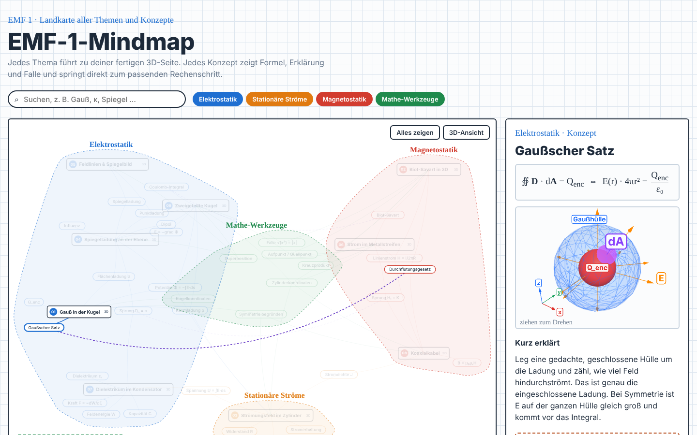
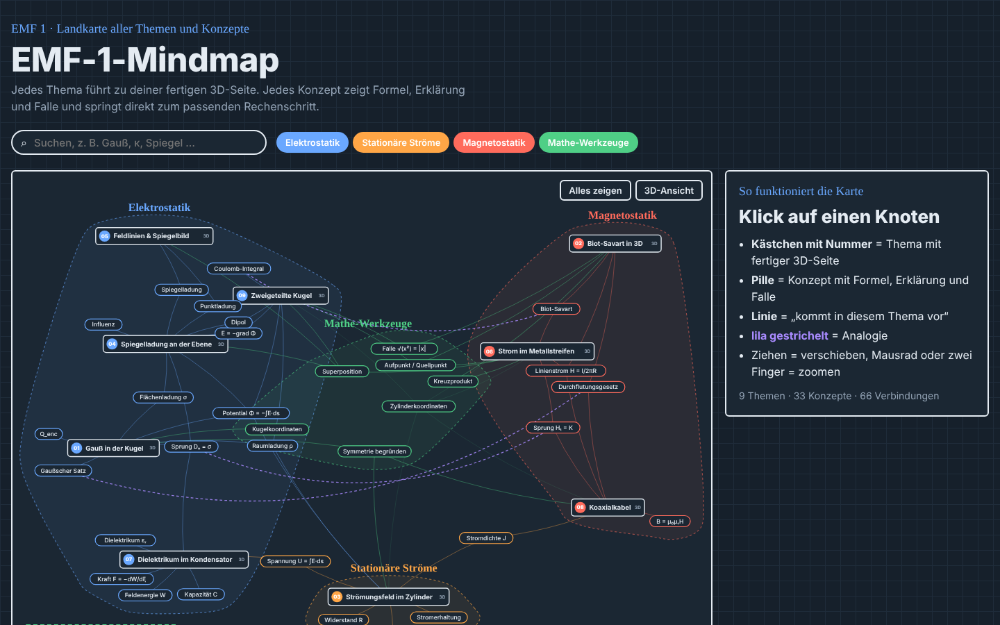
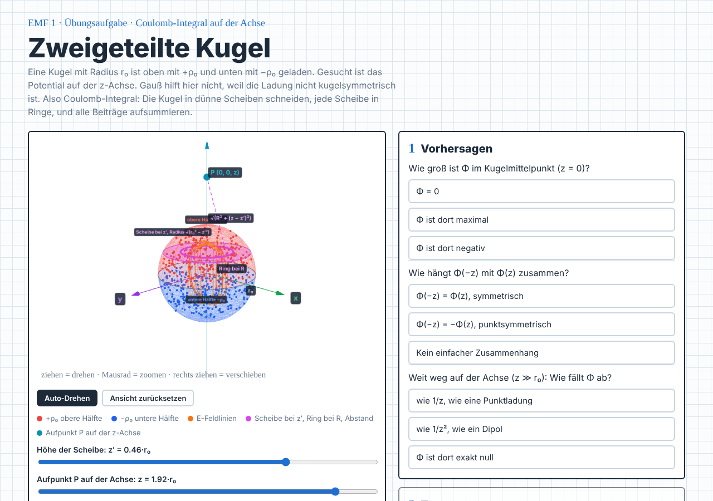

# amo-skills

[English](README.md) · **Deutsch**

Ein Claude-Code-Plugin-Marketplace mit Skills für interaktives Lernmaterial.

| Skill | Was er macht |
|---|---|
| [`mindmaphtml`](skills/mindmaphtml/SKILL.md) | Baut eine interaktive Lern-Mindmap als offline nutzbare HTML-Dateien. Sie hat eine 2D-Konzeptkarte, ein Seitenfenster pro Konzept mit kleiner 3D-Figur oder Mini-Quiz und Links zu interaktiven Aufgabenseiten mit Lösungsweg. |



**[▶ Live-Demo ausprobieren](https://mowolf7.github.io/amo-skills/)** (EMF-1-Beispiel, läuft im Browser)

## Installation

In Claude Code:

```
/plugin marketplace add mowolf7/amo-skills
/plugin install amo-skills@amo-skills
```

Danach Claude um eine Mindmap bitten, zum Beispiel: *„mindmaphtml für mein Fach, hier sind meine Übungsblätter“*.

## mindmaphtml

### Vorteile

- **Läuft offline.** Mindmap und Aufgabenseiten sind normale HTML-Dateien, alle Bibliotheken sind eingebettet. Nichts wird aus dem Internet geladen, die Dateien öffnen sich also auch vom USB-Stick, im Zug oder ohne WLAN.
- **Spart Tokens.** Hochgeladenes Material (PDF, Word, Folien, Tabellen …) wird am Anfang einmal in Markdown umgewandelt. Danach sucht und liest Claude nur die Stellen, die gebraucht werden, statt die Originale immer wieder komplett zu öffnen. Lange Sitzungen werden dadurch günstiger und die Antworten genauer.
- **Passt zu jedem Fach.** Wo 3D hilft, gibt es 3D-Modelle und -Figuren. Wo nicht, gibt es stattdessen Simulationen des Lösungswegs, mehr Aufgabentypen und ein Mini-Quiz pro Konzept.
- **Geprüfte Lösungen.** Jede Lösung wird mit der Musterlösung abgeglichen, wenn es eine gibt, und zusätzlich unabhängig geprüft (symbolisch oder numerisch).
- **Echte 3D-Modelle, wo es sie gibt.** Eine geprüfte Liste offen lizenzierter Modell-Quellen pro Fach ([`sources.md`](skills/mindmaphtml/sources.md)), zuerst Medizin: echte Knochen, Muskeln, Organe, Gefäße und Nerven statt selbst gezeichneter Formen, mit automatischer Quellenangabe.
- **Geliefert, wie dein Gerät es braucht.** Zu Beginn jeder Anfrage fragt Claude, ob du einen Online-Link oder eine ZIP mit Offline-HTML-Dateien möchtest, und empfiehlt eins passend zum Gerät (Online-Link für iPad, iPhone und Android; ZIP für Laptop und PC).
- **Immer gleiches Design.** Aussehen und Code kommen aus einer festen Vorlage, nur der Inhalt ist neu.

### Was du bekommst

- **2D-Konzeptkarte** mit festen Plätzen wie eine Landkarte. Jeder Bereich hat seine eigene Zone, gemeinsame Konzepte liegen zwischen ihren Themen, Werkzeuge in der Mitte. Zoomen, Verschieben, Suchen und Filtern nach Bereich sind möglich. Ein Klick auf einen Knoten hebt seine Nachbarn hervor.
- **Seitenfenster pro Konzept** mit Formel, Erklärung in Alltagssprache, typischer Falle (⚠), Merksatz und entweder einer drehbaren 3D-Figur oder einem Mini-Quiz.
- **Aufgabenseiten**, eine pro Aufgabe. Jede hat ein interaktives 3D-Modell oder eine Simulation des Lösungswegs, drei Lernschritte (Vorhersagen → Testen → Beweisen), Übungs-Tabs (Multiple Choice, Zuordnen, Lückentext, Reihenfolge, Freitext mit Musterantwort) und eine Klausurlösung Schritt für Schritt.
- **Sprungmarken** von jedem Konzept direkt zum passenden Lösungsschritt auf einer Aufgabenseite.
- **Optionale 3D-Netzansicht** der ganzen Karte.
- Hell- und Dunkelmodus. Funktioniert auf dem Handy ohne waagrechtes Scrollen.

### Fächer ohne 3D

Bei theoretischen Fächern, bei Fragen mit langen Antworten in eigenen Worten, bei Rechnungen ohne räumliches Bild oder überall sonst, wo 3D nichts erklärt, wird kein 3D erzwungen. Der Skill baut die Aufgabenseiten dann aus [`aufgabe_muster_ohne3d.html`](skills/mindmaphtml/template/aufgabe_muster_ohne3d.html): mit einer Schritt-für-Schritt-Simulation des Lösungswegs, mehr Aufgabentypen und einem Mini-Quiz im Seitenfenster. Themen mit und ohne 3D lassen sich in einer Karte mischen.

### Beispiel: EMF 1 (Elektromagnetische Felder)

[`examples/emf1/`](examples/emf1/) enthält eine fertige Mindmap mit 9 Aufgabenseiten, 33 Konzepten und 6 eigenen 3D-Figuren. Ausprobieren direkt im Browser in der **[Live-Demo](https://mowolf7.github.io/amo-skills/)**, oder das Repo klonen und `examples/emf1/index.html` öffnen. Die lokale Kopie braucht kein Internet.

| Mindmap (dunkel) | Aufgabenseite |
|---|---|
|  |  |

### So funktioniert es

Der Skill hält **Design und Code fest** und schreibt den **Inhalt jedes Mal neu**:

| Bleibt gleich (aus [`template/`](skills/mindmaphtml/template/)) | Neu bei jeder Mindmap |
|---|---|
| Layout, Farben, Schriften, Hell/Dunkel | Themen, Konzepte, Formeln, Erklärungen, Fallen |
| Karte, Seitenfenster, Quiz und 3D-Technik (`map.js`, `panel.js`, `fig.js`, `net3d.js`) | Aufgabenseiten mit 3D-Modell oder Simulation, Übungen und Lösung |
| 3D-Hilfsfunktionen: Achsen, Beschriftungen, Kamera (`figb.js`) | Alle 3D-Figuren bzw. Quizze zum neuen Fach |
| Build- und Offline-Skript (`build.py`, `offline.py`), Seitengerüste, Sprungmarken-Snippet | `data.js` (der ganze Inhalt der Karte) |

`build.py` fügt Vorlage, Daten und den Stil einer Aufgabenseite zu **einer offline nutzbaren HTML-Datei** zusammen. `offline.py` macht die Aufgabenseiten offline-fähig und meldet alles, was noch aus dem Internet käme:

```bash
python3 -I build.py data.js <Seitenordner> <Stil-Seite.html> 00_Fach_Mindmap.html
python3 -I offline.py <Seitenordner>/*.html
```

### Voraussetzungen

| Wofür | Werkzeug | Pflicht? |
|---|---|---|
| Bauen, Vorschau und Tests | Python 3, Node.js, [Playwright](https://playwright.dev) mit Chromium | ja |
| Hochgeladenes Material in Markdown umwandeln | Claudes Dokument-Skills (`pdf`, `docx`, `pptx`, `xlsx`) oder Kommandozeilen-Werkzeuge | empfohlen |
| Lösungen prüfen | [SymPy](https://www.sympy.org) | empfohlen |
| Neue 3D-Figuren im Chat ansehen | ein Three.js-3D-Viewer-Connector | optional, sonst Playwright-Screenshots |
| Ergebnis online stellen | Claudes Artifact-Werkzeug (standardmäßig privat) | optional |
| Dateien auf dem eigenen Computer aus einer Cloud-Sitzung lesen und schreiben | ein Connector für Ordner auf dem eigenen Computer | optional |

Die Bibliotheken der fertigen Seiten ([d3](https://d3js.org) 7.8.5, [Three.js](https://threejs.org) r128 + OrbitControls) liegen dem Skill in `template/vendor/` bei und werden automatisch eingebettet. Der Skill braucht keine API-Schlüssel und keine Konten.

## Aufbau des Repos

```
.claude-plugin/
  marketplace.json        # Marketplace-Definition
  plugin.json             # Plugin-Manifest
skills/mindmaphtml/
  SKILL.md                # Anleitung, der Claude folgt
  sources.md              # geprüfte offene 3D-Modell-Quellen pro Fach
  template/               # feste Bausteine (HTML, JS, Build-, Offline- und Test-Skripte)
    vendor/               # eingebettete Bibliotheken mit ihren Lizenzen
examples/emf1/            # fertiges Offline-Beispiel (Mindmap + 9 Aufgabenseiten)
docs/                     # Screenshots für diese README
.github/workflows/        # automatische Prüfung und Live-Demo
CHANGELOG.md              # Versionsverlauf
```

## Einen Skill hinzufügen

`skills/<name>/SKILL.md` mit `name` und `description` im Frontmatter anlegen und vor einem Pull Request `claude plugin validate .` ausführen.

## Sprache

Vorlage und Beispiel sind auf Deutsch. Benutzt du den Skill in einer anderen Sprache, antwortet Claude in dieser Sprache und übersetzt die Beschriftungen.

## Lizenz

[MIT](LICENSE) © mowolf7. Mitgelieferte Bibliotheken behalten ihre eigenen Lizenzen: d3 (ISC) und Three.js (MIT), siehe `skills/mindmaphtml/template/vendor/`.
