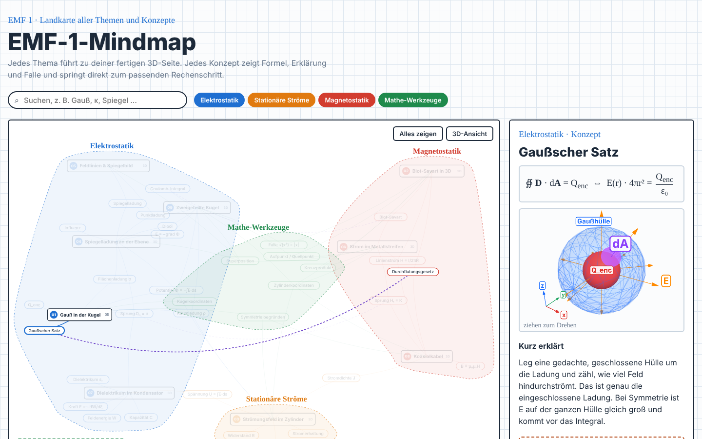
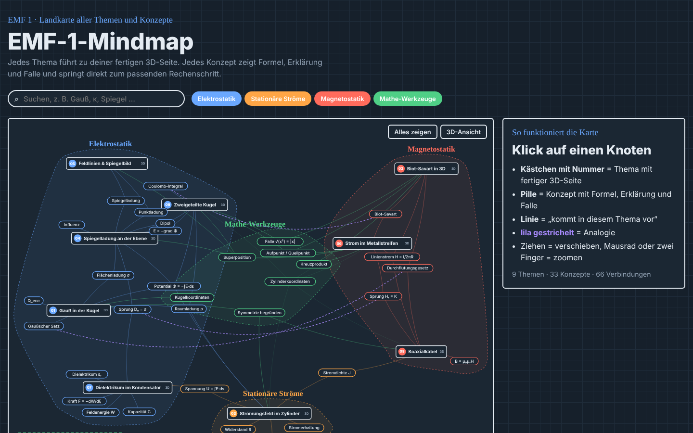
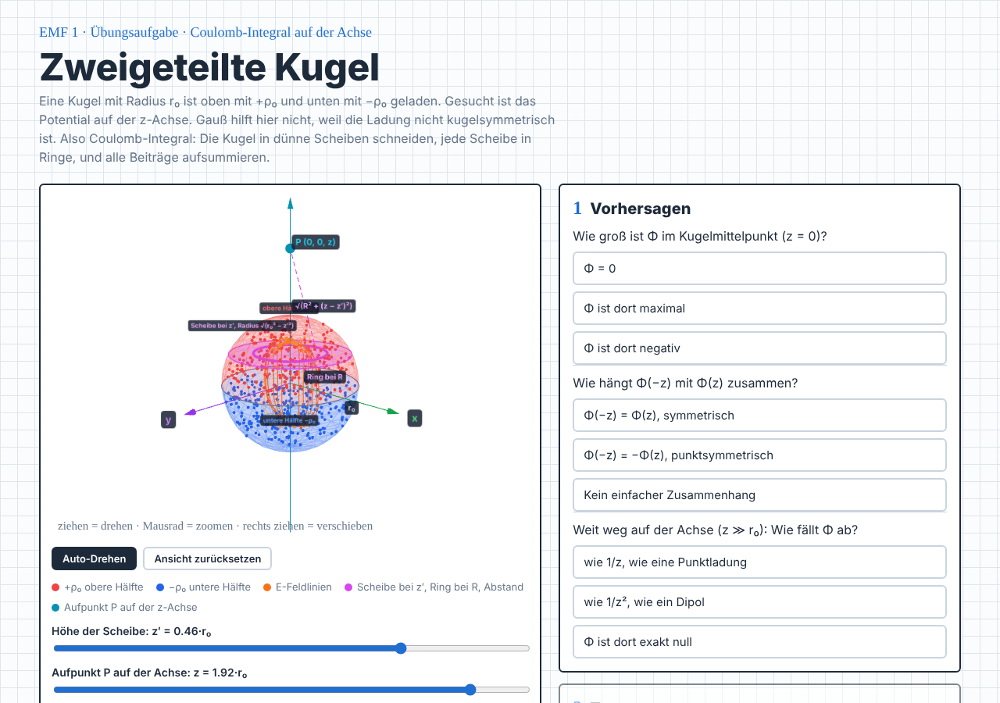

# amo-skills

**English** · [Deutsch](README.de.md)

A Claude Code plugin marketplace with skills for building interactive study material.

| Skill | What it does |
|---|---|
| [`mindmaphtml`](skills/mindmaphtml/SKILL.md) | Builds an interactive learning mind map as offline HTML files. It has a 2D concept map, a side panel for each concept with a mini 3D figure or a mini quiz, and links to interactive exercise pages with worked solutions. |



## Installation

In Claude Code:

```
/plugin marketplace add mowolf7/amo-skills
/plugin install amo-skills@amo-skills
```

Then ask Claude for a mind map, for example: *"mindmaphtml for my course, here are my exercise sheets"*.

## mindmaphtml

### Why use it

- **Works offline.** The mind map and every exercise page are plain HTML files with all libraries embedded. Nothing is loaded from the internet, so they open from a USB stick, in a plane or in an exam room without Wi-Fi.
- **Uses fewer tokens.** Uploaded material (PDF, Word, slides, spreadsheets …) is converted to Markdown once at the start. After that Claude searches and reads only the parts it needs instead of opening the originals again and again. This makes long sessions cheaper and the answers more precise.
- **Fits any subject.** Where 3D helps, you get 3D models and figures. Where it does not, you get simulations of the solution path, more exercise types and a mini quiz per concept instead.
- **Checked solutions.** Every solution is compared with the official model solution when one exists, and checked independently (symbolically or numerically).
- **Same look every time.** Design and code come from a fixed template; only the content is new.

### What you get

- **2D concept map** with fixed positions like a landmap. Each subject area has its own zone, shared concepts sit between their topics, and tools sit in the centre. You can zoom, pan, search and filter by area. Clicking a node highlights its neighbours.
- **Side panel per concept** with the formula, a plain-language explanation, a typical trap (⚠), a mnemonic, and either a rotatable mini 3D figure or a mini quiz.
- **Exercise pages**, one per task. Each has an interactive 3D model or a simulation of the solution path, three learning steps (predict → test → prove), practice tabs (multiple choice, matching, fill in the blanks, ordering, free text with a model answer) and an exam-style solution worked out step by step.
- **Jump links** from every concept straight to the matching solution step on an exercise page.
- **Optional 3D network view** of the whole map.
- Light and dark mode. Works on phones without horizontal scrolling.

### Subjects without 3D

For theoretical subjects, questions that need long written answers, calculations without a spatial picture, or anything else where 3D does not help, the skill does not force 3D. It builds exercise pages from [`aufgabe_muster_ohne3d.html`](skills/mindmaphtml/template/aufgabe_muster_ohne3d.html) instead: a step-by-step simulation of the solution path, more exercise types, and a mini quiz in the side panel. 3D and non-3D topics can be mixed in one map.

### Example: EMF 1 (electromagnetic fields)

[`examples/emf1/`](examples/emf1/) holds a complete mind map in German with 9 exercise pages, 33 concepts and 6 custom 3D figures. To try it, clone the repo and open `examples/emf1/index.html` in a browser. No internet connection is needed.

| Mind map (dark mode) | Exercise page |
|---|---|
|  |  |

### How it works

The skill keeps the **design and code fixed** and writes the **content fresh** each time:

| Stays the same (from [`template/`](skills/mindmaphtml/template/)) | New for every mind map |
|---|---|
| Layout, colours, fonts, light/dark mode | Topics, concepts, formulas, explanations, traps |
| Map, panel, quiz and 3D engine (`map.js`, `panel.js`, `fig.js`, `net3d.js`) | Exercise pages with 3D model or simulation, exercises and solution |
| 3D helpers: axes, labels, camera (`figb.js`) | All 3D figures or quizzes for the new subject |
| Build and offline scripts (`build.py`, `offline.py`), page skeletons, jump-link snippet | `data.js` (the full content of the map) |

`build.py` combines the template, the data file and the style of an exercise page into **one offline HTML file**. `offline.py` makes the exercise pages offline-ready and reports anything that would still load from the internet:

```bash
python3 -I build.py data.js <pages-folder> <style-page.html> 00_Subject_Mindmap.html
python3 -I offline.py <pages-folder>/*.html
```

### Requirements

| Needed for | Tool | Required? |
|---|---|---|
| Building, previews and tests | Python 3, Node.js, [Playwright](https://playwright.dev) with Chromium | yes |
| Converting uploaded material to Markdown | Claude's document skills (`pdf`, `docx`, `pptx`, `xlsx`) or command-line tools | recommended |
| Checking solutions | [SymPy](https://www.sympy.org) | recommended |
| Previewing new 3D figures in the chat | a Three.js 3D viewer connector | optional, falls back to Playwright screenshots |
| Hosting the result online | Claude's Artifact tool (private by default) | optional |
| Reading and writing files on your own computer from a cloud session | a remote computer / folder connector | optional |

The libraries in the generated pages ([d3](https://d3js.org) 7.8.5, [Three.js](https://threejs.org) r128 + OrbitControls) ship with the skill in `template/vendor/` and are embedded automatically. The skill does not need API keys or accounts.

## Repository layout

```
.claude-plugin/
  marketplace.json        # marketplace definition
  plugin.json             # plugin manifest
skills/mindmaphtml/
  SKILL.md                # instructions Claude follows
  template/               # fixed building blocks (HTML, JS, build, offline + test scripts)
    vendor/               # embedded libraries with their licenses
examples/emf1/            # finished offline example (mind map + 9 exercise pages)
docs/                     # screenshots for this README
.github/workflows/        # automatic checks on every pull request
CHANGELOG.md              # version history
```

## Adding a skill

Create `skills/<name>/SKILL.md` with `name` and `description` frontmatter, then run `claude plugin validate .` before you open a pull request.

## Language

The template and the example are in German. When you use the skill in another language, Claude answers in that language and translates the interface labels.

## License

[MIT](LICENSE) © mowolf7. Bundled libraries keep their own licenses: d3 (ISC) and Three.js (MIT), see `skills/mindmaphtml/template/vendor/`.
